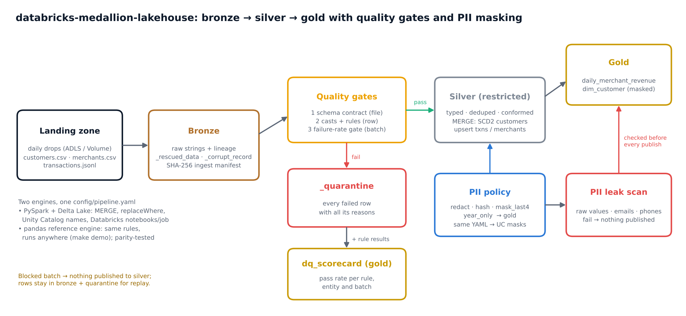
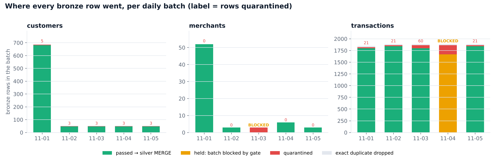
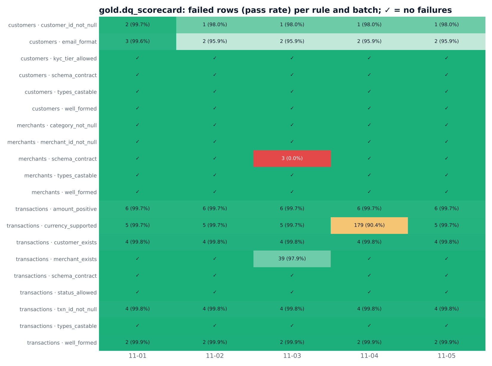
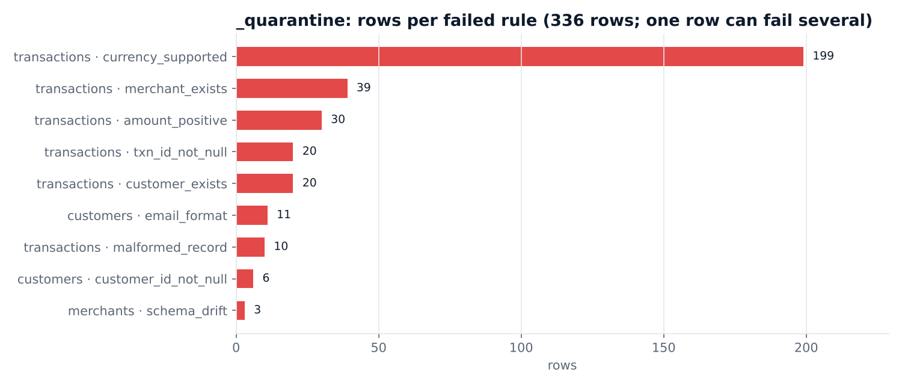
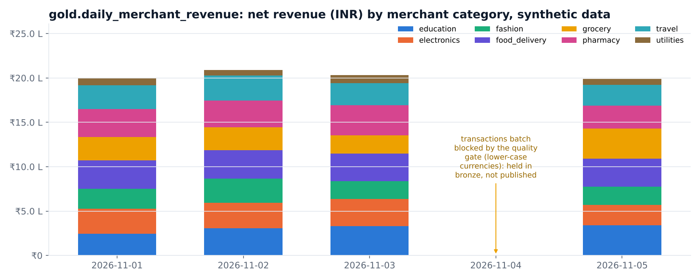
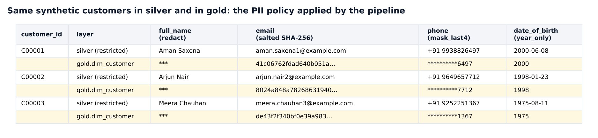

# Databricks Medallion Lakehouse

[](https://github.com/vishavjit-singh/databricks-medallion-lakehouse/actions/workflows/ci.yml)


A bronze → silver → gold lakehouse for a (synthetic) digital-payments wallet. The focus is the part that decides whether anyone can trust the tables: **data-quality gates** at three levels, **idempotent Delta `MERGE`s** (SCD2 history for customers, newest-wins upserts for transactions), and **column-level PII masking**. Masking is driven by one policy file, which also generates the Unity Catalog column masks. A leak scan refuses to publish gold if raw PII ever reaches it.

The pipeline is written twice from one `config/pipeline.yaml`. One version is **PySpark + Delta Lake**: Databricks notebooks, a Databricks Asset Bundle job and Unity Catalog names. The other is a small **pandas reference engine** with the same rules. `make demo` and the unit tests run the reference engine on any laptop, and a parity test runs both engines on the same files and compares every layer.



## Why this project

Most medallion examples show three folders and a `groupBy`. The hard part is what happens when the source misbehaves, so the synthetic generator makes it misbehave every day:

| Problem in a real landing zone | How the pipeline handles it |
|---|---|
| Upstream renames a column (`category` → `merchant_category`) | **Schema contract (file level).** The whole file goes to quarantine as `schema_drift:category`. The renamed column is still kept in bronze `_rescued_data`, so nothing is lost |
| A new field appears that nobody asked for (`device_os`) | Not an error: it lands in `_rescued_data` as JSON and the contracted columns load normally |
| Broken JSON lines, values that don't cast, null keys, bad emails, negative amounts, unknown currencies | **Row rules** from YAML (`not_null`, `regex`, `accepted_values`, `range`, `foreign_key`) plus parse and cast checks. A failing row goes to `_quarantine` with **every** rule it failed and its raw record |
| A transaction points at a customer or merchant that doesn't exist | `foreign_key` rule against silver, evaluated in dependency order (customers and merchants before transactions) |
| An upstream bug breaks 9% of a day's rows: publish the other 91%? | **Batch gate.** Above `max_failure_rate` the batch is **blocked**: nothing reaches silver, so reports never show half a day. The rows stay in bronze and quarantine |
| The same file or row is delivered twice | SHA-256 **ingest manifest** (the job Auto Loader's checkpoint does), exact-duplicate removal, newest-version-per-key within a batch |
| Customers move city or change KYC tier, and analysts need "as of" answers | **SCD2 `MERGE`**: tracked changes close the current version (`valid_to`, `is_current`) and open a new one. Replays and older versions change nothing |
| A refund arrives three days after the payment | **Upsert `MERGE`**, newest `updated_at` wins. A stale replay can't overwrite newer data |
| Silver holds names, emails, phones and birth dates | **PII policy** (`redact`, salted `hash`, `mask_last4`, `year_only`) applied to every consumer table. The same YAML generates **Unity Catalog column masks** for silver. The salt comes from a secret scope backed by Key Vault, never from code |
| Someone forgets to mask a new gold column | **Leak scan** before every gold publish: known raw values, email and phone patterns. A finding fails the run and nothing is written (there is a test for exactly this) |

## Results from the demo run

`make demo` generates five days of **synthetic** landing files: 800 customers, 60 merchants and about 1,800 transactions a day, with the faults above. It runs each day through bronze, silver and gold, then renders these images from the tables it wrote.

**Where every bronze row went.** Day 3's merchants file arrives with a renamed column and is rejected whole. Day 4's transactions trip the batch gate (10.4% failed against a 5% limit):



**`gold.dq_scorecard`**, one cell per rule and batch. Day 3's merchant orphans come from the rejected merchants file: those merchants only reached silver when upstream re-sent them on day 4:





**`gold.daily_merchant_revenue`.** The blocked day is visible as a gap, which is the point of the gate: a known hole, not a silently wrong number.



**The PII policy at work.** The same synthetic customers in restricted silver and in gold:



| Metric (demo run, synthetic data, seed 11) | Value |
|---|---|
| Landing files → bronze rows | 15 files → 10,358 rows (2 files with rescued extra columns) |
| Exact duplicates dropped | 145 |
| Rows quarantined | 336, across 9 distinct reasons |
| Batches blocked by a gate | 2 of 15 entity-batches: `2026-11-03 merchants` (schema drift), `2026-11-04 transactions` (failure rate) |
| `silver.customers` | 857 versions for 800 customers, 56 with SCD2 history |
| `silver.transactions` | 7,172 unique transactions, 120 of them refunded by a later update |
| Gold | 38 revenue rows · 800 masked customers · 115 scorecard rows |
| PII leak findings in gold | 0 (a test proves the scan fails the run when masking is skipped) |
| Re-running any batch | Identical silver (tested): manifest skips files, MERGEs are idempotent |

> All data is synthetic, generated by [`lakehouse/generator.py`](src/lakehouse/generator.py) with a fixed seed: names come from short word lists and emails use `example.com`. Every number above comes from `python -m lakehouse summary` and is reproducible. The FX rates in the config are illustrative, not market data.

## Tables

| Layer | Table | Contents | Write |
|---|---|---|---|
| bronze | `customers`, `merchants`, `transactions` | every source row as strings + `_rescued_data`, `_corrupt_record`, `_source_file`, `_line_no`, `_batch_id`, `_ingested_at` | append |
| bronze | `_ingest_manifest` | file path, SHA-256, missing/extra columns, corrupt rows | append |
| silver | `customers` | typed, validated; SCD2 (`valid_from`, `valid_to`, `is_current`); raw PII, so restricted | `MERGE` |
| silver | `merchants`, `transactions` | typed, validated, newest per key; `amount_inr` conformed | `MERGE` |
| silver | `_quarantine` | failed rows: batch, file, line, reasons, raw record | `replaceWhere` per batch |
| silver | `_dq_results` | checked / failed per rule, entity and batch, plus the gate decision | `replaceWhere` per batch |
| gold | `daily_merchant_revenue` | payments, failures, refunds, gross/refunded/net INR, paying customers per day and category | overwrite |
| gold | `dim_customer` | current version, masked, with lifetime metrics | overwrite |
| gold | `dq_scorecard` | pass rate per rule, entity and batch | overwrite |

## Two engines, one config

| | PySpark + Delta ([`spark/jobs.py`](src/lakehouse/spark/jobs.py)) | Reference engine ([`quality.py`](src/lakehouse/quality.py), [`silver.py`](src/lakehouse/silver.py), [`gold.py`](src/lakehouse/gold.py)) |
|---|---|---|
| Storage | Delta tables by path, or Unity Catalog `catalog.layer.table` | Small versioned table store: data files + an exclusive-create commit log ([`storage.py`](src/lakehouse/storage.py)) |
| Casting | `try_cast` (safe with ANSI mode on) | `pd.to_datetime` / `to_numeric` with `errors="coerce"` |
| SCD2 | `MERGE` with the staged-union pattern (changed rows twice, one with a NULL merge key) | merge + close + insert in pandas |
| Upsert | `MERGE … WHEN MATCHED AND s.updated_at >= t.updated_at` | newest-wins on the key |
| Audit tables | `replaceWhere batch_id = … AND entity = …` | replace the batch's rows |
| Masking | `sha2`, `repeat`/`right`, `year` | `hashlib`, string slicing |
| Runs where | Databricks job (bundle), `docker compose`, the Spark workflow | anywhere with Python: `make demo`, unit tests |

[`tests/spark/test_spark_parity.py`](tests/spark/test_spark_parity.py) runs both engines on the same landing files and asserts equal gate decisions and counts, DQ results, quarantine rows, SCD2 history, transactions and gold. Money columns are compared within 1–5 paise, because Spark uses decimals and the reference engine uses floats. These tests run in the separate **Spark + Delta** workflow ([`.github/workflows/spark.yml`](.github/workflows/spark.yml)), which installs Java 17, PySpark and delta-spark.

## Quickstart

```bash
git clone https://github.com/vishavjit-singh/databricks-medallion-lakehouse.git
cd databricks-medallion-lakehouse
python -m venv .venv && source .venv/bin/activate
make install
make demo      # synthetic landing zone → bronze → silver → gold → charts → summary → UC mask SQL
make test      # 50 tests (the 6 Spark parity tests are skipped without pyspark)
```

### Spark + Delta Lake locally

```bash
make install-spark            # pyspark 3.5 + delta-spark 3.2; needs Java 17
make generate spark-demo      # same landing files → Delta tables in data/spark_lake
make test-spark               # parity tests
```

### Docker

```bash
docker compose up --build     # 1) reference engine end to end  2) Spark + Delta on the same files
```

### Databricks

```bash
databricks bundle validate
databricks bundle deploy -t dev
databricks bundle run medallion_daily -t dev --params batch_id=2026-11-01
```

The bundle ([`databricks.yml`](databricks.yml)) deploys one job with three notebook tasks: [`01_bronze_ingest`](notebooks/01_bronze_ingest.py) → [`02_silver_quality`](notebooks/02_silver_quality.py) → [`03_gold_marts`](notebooks/03_gold_marts.py). The notebooks are thin wrappers: widgets, the secret scope, and Unity Catalog names around the tested package. [`00_setup`](notebooks/00_setup.py) creates the schemas and applies the generated column masks. It expects a Unity Catalog workspace, a Volume for the landing zone and a secret scope holding `pii-hash-salt`. The bundle and notebooks have not been run against a live workspace as part of this repo's CI.

## CLI

```bash
python -m lakehouse generate                     # synthetic landing files, one folder per day
python -m lakehouse run [--batch 2026-11-03]     # reference engine, all days or selected ones
python -m lakehouse report                       # charts in docs/images
python -m lakehouse summary                      # the numbers quoted above, as JSON
python -m lakehouse history silver.customers     # commit log: version, operation, MERGE metrics
python -m lakehouse uc-sql --catalog main        # Unity Catalog column-mask SQL from the PII policy
python -m lakehouse spark [--catalog main]       # PySpark + Delta, by path or Unity Catalog name
```

Adding a rule is a YAML change. Both engines pick it up, the scorecard gets a row, and the parity test covers it:

```yaml
transactions:
  rules:
    - {name: channel_allowed, type: accepted_values, column: channel, values: [app, web, pos]}
  gate:
    max_failure_rate: 0.05
```

## Project structure

```
├── config/pipeline.yaml        # entities, schemas, rules, gates, merge modes, PII policy
├── src/lakehouse/
│   ├── generator.py            # synthetic landing zone with injected faults
│   ├── bronze.py               # parse, rescue, corrupt-record capture, ingest manifest
│   ├── quality.py              # schema contract, casts, rules, batch gate
│   ├── silver.py               # SCD2 and upsert merges, conforming
│   ├── gold.py                 # marts + scorecard
│   ├── masking.py              # PII policy, leak scan, Unity Catalog SQL
│   ├── storage.py              # versioned local table store (reference engine)
│   ├── pipeline.py             # one batch through all layers
│   ├── report.py               # README charts and summary
│   ├── cli.py
│   └── spark/jobs.py           # PySpark + Delta implementation (bronze / silver / gold entry points)
├── notebooks/                  # Databricks notebooks (source format)
├── databricks.yml              # Databricks Asset Bundle: daily 3-task job
├── sql/unity_catalog_masks.sql # generated column masks
├── tests/                      # 50 unit + end-to-end tests; tests/spark = parity tests
├── Dockerfile · docker-compose.yml · Makefile
└── .github/workflows/          # ci.yml (lint, tests, demo, docker) · spark.yml (parity, compose)
```

## Testing

```bash
make lint && make test
```

- **Rules and casts:** every rule type, null handling, schema drift, malformed records and the gate threshold (5% exactly passes, above blocks)
- **Merges:** SCD2 insert, change, no-op, stale and replay; upsert newest-wins and stale replay
- **Masking:** each method, the salt from the environment, the leak scan, and the generated SQL
- **Storage:** time travel, a CSV round-trip that keeps types, and two writers racing for one version (the second fails instead of overwriting)
- **End to end:** the generator records the truth, and the tests check silver against it. Current customer attributes, merchants after the re-send, and unique transactions with refunds applied all must match. They also check that nothing from a blocked batch reaches silver, that gold reconciles with silver, that gold holds no raw PII, and that a re-run changes nothing
- **Parity (Spark workflow):** both engines on the same files, compared layer by layer

## Limitations and roadmap

- The data is synthetic and small (about 10k rows). The Spark job is written for scale, but no performance numbers are claimed.
- The Databricks bundle and notebooks are written to the documented formats but have not been deployed from CI. Bronze on Spark uses the shared Python parser rather than Auto Loader, so the same parsing rules run everywhere. An Auto Loader (`cloudFiles` with `rescuedDataColumn`) variant is next.
- A blocked batch currently needs a manual re-run once the source is fixed. A `replay` command that re-reads quarantined rows from bronze would close that loop.
- Refunds for transactions held by a blocked batch arrive as standalone `refunded` rows until the batch is replayed.
- Next: Delta Live Tables expectations as an alternative gate implementation, `OPTIMIZE`/`VACUUM` maintenance tasks, and data-contract checks in CI for the YAML.

## Author

**Vishavjit Singh Saini**, Data Engineer
[Portfolio](https://vishavjit-saini.pages.dev/) · [LinkedIn](https://www.linkedin.com/in/vishavjit-singh-7011211ab/) · [GitHub](https://github.com/vishavjit-singh)

## License

[MIT](LICENSE)
